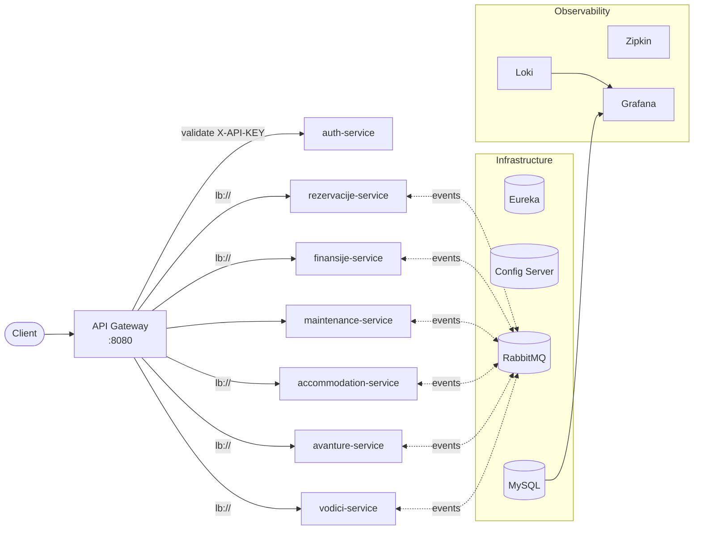

# Eco Travel — Microservice Travel Platform


A booking and management platform for eco-tourism: accommodation, reservations, payments, adventure tours, tour guides and maintenance. It is built as a set of independently deployable **Spring Boot microservices**, with an API gateway, service discovery, centralized configuration, event-driven messaging and a full observability stack.

Built as a team project for the *Systems Programming* course at the School of Computing (RAF), Belgrade.

---

## Architecture



| Service | Responsibility | Port (internal) |
|---|---|---|
| `gateway-service` | Single entry point, routing, API-key auth, role checks, trace propagation | 8080 |
| `auth-service` | Users, roles and API-key validation | 8086 |
| `rezervacije-service` | Bookings, guests, add-ons, cancellation policies, booking status log | 8082 |
| `finansije-service` | Invoices, transactions, payment methods, tax rates | 8083 |
| `accommodation-service` | Units, addresses, facilities, seasonal price tiers, availability calendar | 8084 |
| `maintenance-service` | Workers, maintenance tasks, work orders | 8085 |
| `avanture-service` | Adventure tours, categories, time slots, gear, reviews | 8088 |
| `vodici-service` | Tour guides, languages, certifications | 8089 |
| `config-service` | Spring Cloud Config Server (native profile, reads `config_repo/`) | 8888 |
| `eureka-server` | Service registry used for client-side load balancing | 8761 |
| `shared-module` | Shared event DTOs used by RabbitMQ producers and consumers | — |

---

## Key features

**API gateway and security**
- Spring Cloud Gateway (WebFlux) with a global filter that validates the `X-API-KEY` header against `auth-service` for every request.
- Role-based rules at the edge: `GUEST` is read-only, `/admin` routes require `ADMIN`. The caller's identity and roles are forwarded downstream as headers.
- Aggregated Swagger UI for all services at the gateway.

**Service discovery and scaling**
- Services register with Eureka. The gateway routes with `lb://`, so requests are spread across replicas.
- Five services run with **3 replicas each** to demonstrate load balancing.

**Synchronous communication and resilience**
- Service-to-service calls with **OpenFeign**.
- **Resilience4j** circuit breakers, retries and timeouts around remote calls.

**Asynchronous, event-driven communication (RabbitMQ topic exchanges)**
- **Payment → booking:** `finansije` publishes `finance.transaction.created`. `rezervacije` marks the booking as paid and sends a `payment-recorded` feedback event back.
- **Booking → cleaning:** `rezervacije` publishes `reservation.booking.created`. `maintenance` automatically creates a cleaning work order and confirms it with a feedback event.
- **Maintenance → availability:** work-order created, completed and deleted events block or release the unit in `accommodation`'s availability calendar.
- **Adventures ↔ guides:** `avanture` and `vodici` keep each other in sync through `adventure.*` and `guide.*` events.

**Observability**
- W3C `traceparent` propagation from the gateway through every service, with **Zipkin** for distributed tracing.
- A uniform log pattern (`service, traceId, spanId`) shipped to **Loki**.
- Four provisioned **Grafana** dashboards: system logs and error rate, plus business analytics for bookings & finance, accommodation & maintenance, and adventures & guides. The business dashboards query MySQL directly.

**Configuration and deployment**
- Centralized configuration in `config_repo/`, served by the Config Server.
- Multi-stage Dockerfiles, health checks and ordered startup (`depends_on: service_healthy`).

---

## Tech stack

Java 21 · Spring Boot 3.5 · Spring Cloud 2025.0 (Gateway, Eureka, Config, OpenFeign) · Spring Data JPA / Hibernate · Resilience4j · RabbitMQ · MySQL 8 · MapStruct · Lombok · SpringDoc OpenAPI · Micrometer Tracing / OpenTelemetry · Zipkin · Loki · Grafana · Docker Compose

---

## Getting started

**Prerequisites:** Docker with Docker Compose v2.

```bash
git clone https://github.com/mldndjsc/eco-travel.git
cd eco-travel

# Linux / macOS
./start.sh

# Windows (PowerShell)
.\start.ps1
```

The script builds all images, starts the stack with 3 replicas of the scalable services, waits for the infrastructure and prints a health report.

> **Note:** `start.sh` / `start.ps1` run `docker volume prune` and `docker network prune`, which remove **all unused** Docker volumes and networks on your machine. If you don't want that, start the stack manually:
>
> ```bash
> docker compose up -d --build
> ```

### Useful URLs

| What | URL | Credentials |
|---|---|---|
| Swagger UI (all services) | http://localhost:8080/swagger-ui.html | — |
| Eureka dashboard | http://localhost:8761 | — |
| RabbitMQ management | http://localhost:15672 | guest / guest |
| Zipkin | http://localhost:9411 | — |
| Grafana | http://localhost:3000 | admin / admin |
| Adminer (DB UI) | http://localhost:8087 | root / root (server `db-mysql`) |

### Example request

Development API keys are seeded by `auth-service` (`admin-key-123`, `guest-key-123`, `guide-key-123`):

```bash
curl -H "X-API-KEY: admin-key-123" http://localhost:8080/api/accommodation/units
```

Requests without a key get `401`. A `GUEST` key gets `403` on `POST`, `PUT` and `DELETE`.

---

## Project structure

```
eco-travel/
├── gateway-service/        # API gateway + global auth/tracing filter
├── auth-service/           # users, roles, API keys
├── rezervacije-service/    # bookings
├── finansije-service/      # invoices & transactions
├── accommodation-service/  # units, pricing, availability
├── maintenance-service/    # work orders
├── avanture-service/       # adventure tours
├── vodici-service/         # tour guides
├── config-service/         # Spring Cloud Config Server
├── config_repo/            # centralized configuration files
├── eureka-server/          # service registry
├── shared-module/          # shared RabbitMQ event classes
├── grafana/provisioning/   # datasources + dashboards
├── scripts/                # SQL seed data
├── docker-compose.yml
└── start.sh / start.ps1
```

Each service has its own `README.md` with its data model and endpoints.

---

## Team

| Member | Services |
|---|---|
| [Mladen Đošić](https://github.com/mldndjsc) | gateway, auth, rezervacije, finansije, config server |
| [Nikola Vasiljević](https://github.com/nikola-vasiljevic04) | accommodation, maintenance, Eureka |
| [Vojislav Popović](https://github.com/Wojo16) | avanture, vodici |
